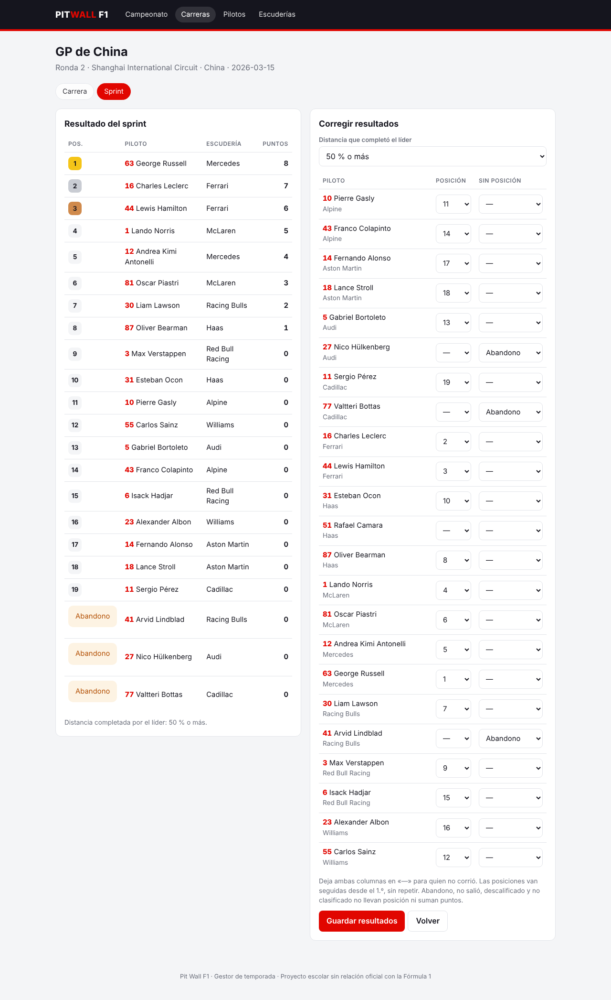
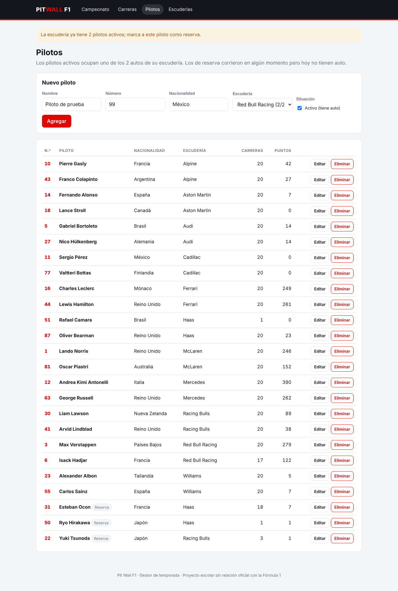
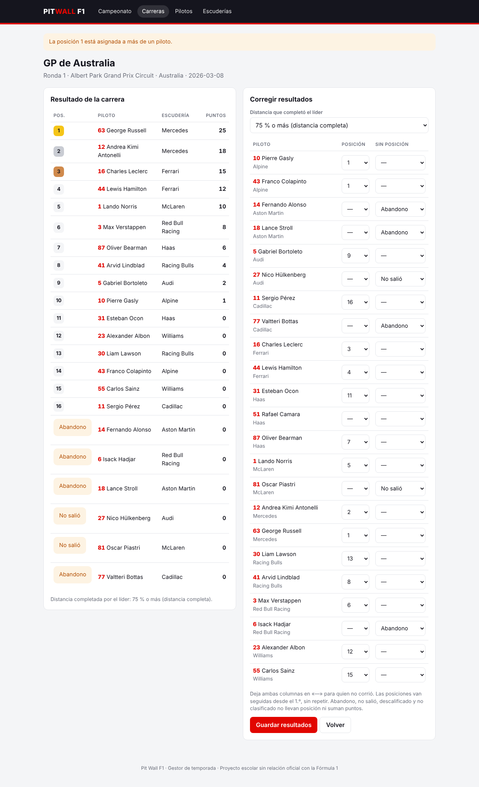

# Pit Wall F1 · Documentación

**Versión 2.0** · Aplicación web en Python para gestionar una temporada de Fórmula 1 con el reglamento 2026 de la FIA.

## 1. Descripción

Pit Wall F1 permite registrar las escuderías, los pilotos y el calendario de una temporada, capturar la clasificación de cada carrera y de cada sprint, y consultar el campeonato de pilotos y de constructores, que se calcula solo a partir de los resultados.

**Usuario:** cualquier persona que lleve el registro de una temporada (aficionado, liga de simulación, profesor). No hay inicio de sesión: la aplicación es de un solo usuario.

**Datos:** la aplicación trae cargada la temporada 2026 real hasta el GP de Brasil (ronda 20, 8 de noviembre de 2026), tomada de la Jolpica F1 API. El campeonato calculado coincide con el oficial en puntos y en orden.

**Fuera de alcance:** clasificación (qualy) y parrilla de salida, penalizaciones de tiempo, empates en una misma posición (*dead heat*) y varias temporadas a la vez.

## 2. Tecnología

| Capa | Herramienta |
|---|---|
| Lenguaje | Python 3.11+ |
| Web | Flask 3 con plantillas Jinja2 (HTML renderizado en el servidor) |
| Base de datos | SQLite (módulo `sqlite3` de Python) |
| Servidor en producción | Gunicorn |
| Pruebas | pytest |
| Despliegue | Render (`render.yaml`) o cualquier plataforma con `Procfile` |

## 3. Requerimientos funcionales

| Clave | Requerimiento |
|---|---|
| RF-01 | Registrar, consultar, editar y eliminar escuderías (nombre y país). |
| RF-02 | Registrar, consultar, editar y eliminar pilotos (nombre, número, nacionalidad, escudería y si está activo o de reserva). |
| RF-03 | Registrar, consultar, editar y eliminar eventos del calendario (ronda, Gran Premio, circuito, país, fecha y si tiene sprint). |
| RF-04 | Registrar y corregir la clasificación de la carrera y del sprint de cada evento: posición de cada piloto o su estado (abandono, no salió, descalificado, no clasificado), y la distancia que completó el líder. |
| RF-05 | Calcular los puntos de cada resultado según el reglamento. |
| RF-06 | Mostrar el campeonato de pilotos y el de constructores, ordenados con los criterios de desempate del reglamento. |
| RF-07 | Avisar en pantalla cuando una operación no cumple una regla de negocio, sin guardar nada. |

## 4. Historias de usuario

| Clave | Historia |
|---|---|
| HU-01 | Como organizador, quiero registrar las escuderías para armar la parrilla. |
| HU-02 | Como organizador, quiero registrar a los pilotos con su número y escudería, incluidos los de reserva que reemplazan a un titular. |
| HU-03 | Como organizador, quiero registrar el calendario, indicando qué fines de semana tienen sprint. |
| HU-04 | Como organizador, quiero capturar la clasificación de cada carrera y sprint para que se asignen los puntos. |
| HU-05 | Como organizador, quiero que no se pueda borrar información con historial para no perder resultados. |
| HU-06 | Como aficionado, quiero ver los campeonatos ordenados como en la Fórmula 1 para saber quién va ganando. |

## 5. Reglas de negocio

Programadas en `app/reglas.py`. Cada una tiene pruebas en `tests/test_reglas.py` con su clave en el nombre de la prueba (por ejemplo, `test_rn004_...`). La columna FIA indica el artículo del reglamento 2026 (Sección A, *General Regulatory Provisions*, edición 02; Sección B, *Sporting*, edición 07) en el que se basa.

| Clave | Regla | FIA | Historia | Criterio de aceptación |
|---|---|---|---|---|
| RN-001 | Los puntos de carrera dependen de la distancia que completó el líder: menos de 2 vueltas, ninguno; 2 vueltas o más, 6-4-3-2-1; 25 % o más, 13-10-8-6-5-4-3-2-1; 50 % o más, 19-14-12-10-8-6-4-3-2-1; 75 % o más, 25-18-15-12-10-8-6-4-2-1. | A2.2.1 | HU-04 | Dada una carrera completa, cuando el 1.º se registra, entonces suma 25 puntos; con menos de 2 vueltas suma 0. |
| RN-002 | El sprint da 8-7-6-5-4-3-2-1 puntos del 1.º al 8.º si el líder completó al menos el 50 % de la distancia; si no, ninguno. | A2.2.2 | HU-04 | Dado un sprint completo, cuando el 1.º se registra, entonces suma 8 puntos. |
| RN-003 | Solo los pilotos clasificados llevan posición y pueden sumar puntos. Abandono, no salió, descalificado y no clasificado suman 0. | A2.2.1 | HU-04 | Dado un piloto con abandono, cuando se le pone posición, entonces se rechaza. |
| RN-004 | Cada escudería inscribe 2 autos: tiene como máximo 2 pilotos activos y como máximo 2 pilotos en cada sesión. | A2.1.3 | HU-02 | Dada una escudería con 2 activos, cuando se registra un tercero como activo, entonces se rechaza; como reserva sí se acepta. |
| RN-005 | Una escudería usa como máximo 4 pilotos distintos en la temporada, contando a los que ya corrieron aunque se hayan ido. | B1.7.1 | HU-02 | Dada una escudería con 4 pilotos usados, cuando se registra un quinto, entonces se rechaza. |
| RN-006 | El número de piloto va del 1 al 99 y no se repite. | — | HU-02 | Dado el número 16 ocupado, cuando otro piloto lo pide, entonces se rechaza. |
| RN-007 | En cada sesión, cada piloto tiene un solo resultado y cada posición un solo piloto; las posiciones van seguidas desde el 1.º. | — | HU-04 | Dados dos pilotos en el 1.er lugar, cuando se guardan, entonces se rechazan y no se guarda nada. |
| RN-008 | Solo se registran resultados de eventos cuya fecha ya pasó, y los de sprint solo en fines de semana con sprint. | — | HU-04 | Dado un evento de mañana, cuando se registran resultados, entonces se rechazan. |
| RN-009 | El campeonato de pilotos suma carreras y sprints. En empate va adelante quien tenga más 1.os lugares en carreras; si siguen empatados, más 2.os lugares, luego 3.os, y así sucesivamente. Los sprints no cuentan para desempatar. Si el empate sigue, el reglamento usa la clasificación (qualy), que la aplicación no registra; en ese caso ordena alfabéticamente. | A2.1.4 | HU-06 | Dados dos pilotos con 25 puntos, uno con una victoria, entonces ese va primero. |
| RN-010 | El campeonato de constructores suma los puntos de los dos autos de cada escudería, con la escudería con la que corrió cada piloto en ese evento (un piloto que cambia de equipo deja sus puntos anteriores en el equipo anterior). Se desempata igual que RN-009. | A2.1.4 | HU-06 | Dado un piloto que gana con Red Bull Racing y luego pasa a otro equipo, entonces esos 25 puntos siguen en Red Bull Racing. |
| RN-011 | No se elimina un piloto con resultados, ni una escudería con pilotos o con resultados. | — | HU-05 | Dado un piloto con resultados, cuando se intenta eliminar, entonces se rechaza. |

## 6. Casos de uso

### CU-01 Registrar un piloto
- **Actor:** organizador.
- **Flujo principal:** 1) Entra a *Pilotos*. 2) Captura nombre, número, nacionalidad y escudería, y marca si está activo. 3) Presiona *Agregar*. 4) El sistema valida RN-004, RN-005 y RN-006, guarda y muestra «Piloto registrado.».
- **Flujo alterno:** si la escudería ya tiene 2 activos, ya usó 4 pilotos o el número está ocupado, no se guarda y se muestra el aviso.

### CU-02 Registrar la clasificación de una carrera o sprint
- **Actor:** organizador.
- **Flujo principal:** 1) Entra a *Carreras* y elige un evento; si tiene sprint, elige la pestaña *Carrera* o *Sprint*. 2) Indica la distancia que completó el líder. 3) Asigna la posición de cada piloto o su estado. 4) Presiona *Guardar resultados*. 5) El sistema valida RN-003, RN-004, RN-005, RN-007 y RN-008, calcula los puntos (RN-001 o RN-002), guarda y actualiza los campeonatos.
- **Flujo alterno:** si hay posiciones repetidas o con huecos, más de 2 autos de una escudería o el evento no se ha corrido, no se guarda nada y se muestra el aviso.

### CU-03 Consultar los campeonatos
- **Actor:** organizador o aficionado.
- **Flujo principal:** 1) Entra a *Campeonato*. 2) El sistema muestra pilotos y constructores ordenados según RN-009 y RN-010, y los próximos eventos.

### CU-04 Eliminar un piloto o una escudería
- **Actor:** organizador.
- **Flujo principal:** 1) Presiona *Eliminar*. 2) El sistema valida RN-011 y elimina.
- **Flujo alterno:** si tiene historial, no se elimina y se muestra el aviso.

## 7. Modelo de datos

| Tabla | Campos | Restricciones |
|---|---|---|
| escuderias | id, nombre, pais | nombre único |
| pilotos | id, nombre, numero, nacionalidad, escuderia_id, activo | número único; escuderia_id → escuderias (escudería actual) |
| carreras | id, ronda, nombre, circuito, pais, fecha, sprint, distancia, distancia_sprint | ronda única |
| resultados | id, carrera_id, sesion, piloto_id, escuderia_id, posicion, estado, puntos | sesión: carrera o sprint; (evento, sesión, piloto) único; (evento, sesión, posición) único; escuderia_id es la escudería con la que corrió ese evento |

## 8. Arquitectura

```
Navegador ──HTTP──▶ rutas.py (pantallas) ──▶ reglas.py (reglas de negocio) ──▶ SQLite
                         │                          │
                    templates/ (HTML)        ReglaNegocioError (aviso en pantalla)
```

Toda escritura a la base de datos pasa por `reglas.py`, incluida la carga de la temporada 2026: los datos reales también se validan con las reglas. Si una operación no cumple una regla, se lanza `ReglaNegocioError` y la pantalla muestra el aviso sin guardar nada.

## 9. Pruebas

43 pruebas automatizadas con pytest, todas en verde:

- `tests/test_reglas.py`: al menos una prueba por regla RN-001 a RN-011.
- `tests/test_web.py`: que cada pantalla cargue, que no muestre claves internas de reglas, que el CRUD funcione desde la web, que volver a guardar un resultado real no cambie el campeonato y que los avisos aparezcan.

Además se verificó que el campeonato calculado con la temporada 2026 sea idéntico al oficial (25 pilotos y 11 escuderías, con puntos y orden de desempate).

Para correrlas: `pytest`. Solo las de reglas: `pytest -k rn -v`.

## 10. Despliegue

El repositorio incluye `render.yaml` para desplegar en Render con el plan gratuito (New + → Blueprint). El paso a paso está en el `README.md`. En el plan gratuito la base de datos vuelve a los datos de la temporada cada vez que el servicio se reinicia.

## 11. Fuentes

- Resultados, calendario y pilotos: Jolpica F1 API, `https://api.jolpi.ca/ergast/f1/2026/`, consultada el 21 de noviembre de 2026.
- Reglas de puntuación, desempate y autos por escudería: FIA, *2026 Formula 1 Regulations, Section A: General Regulatory Provisions*, edición 02 (27 de febrero de 2026), artículos A2.1.3, A2.1.4 y A2.2.
- Número máximo de pilotos por escudería: FIA, *2026 Formula 1 Regulations, Section B: Sporting*, edición 07 (25 de junio de 2026), artículo B1.7.1.

## 12. Capturas


*Campeonato 2026 de pilotos y constructores, hasta el GP de Brasil.*


*Clasificación del sprint del GP de China y formulario para corregirla.*


*Aviso al intentar registrar un tercer piloto activo en una escudería.*


*Aviso al asignar el mismo lugar a dos pilotos; no se guarda nada.*
