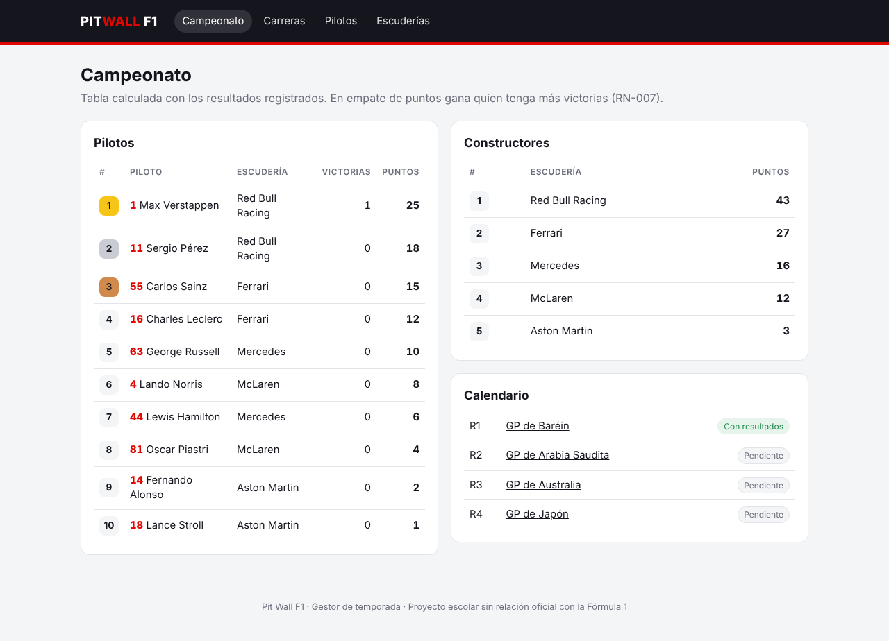
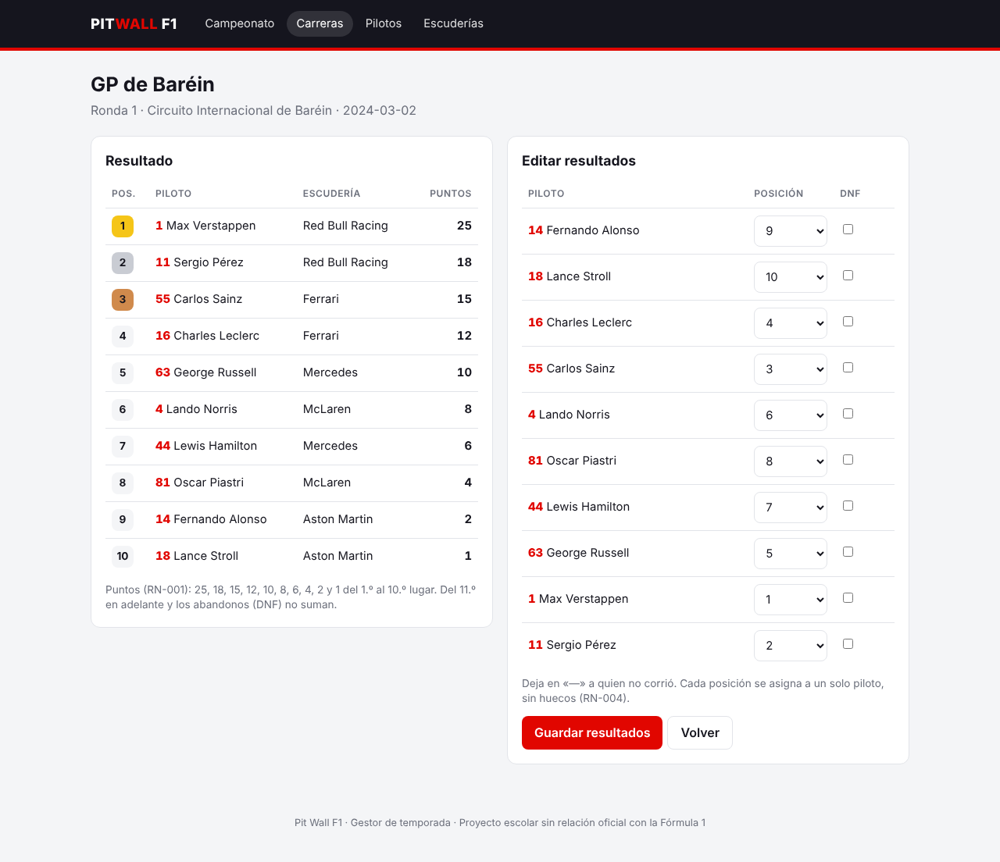
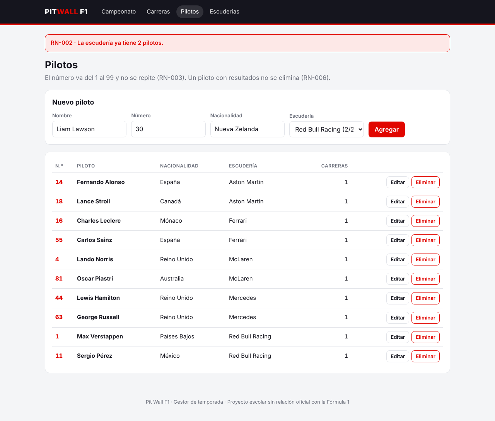
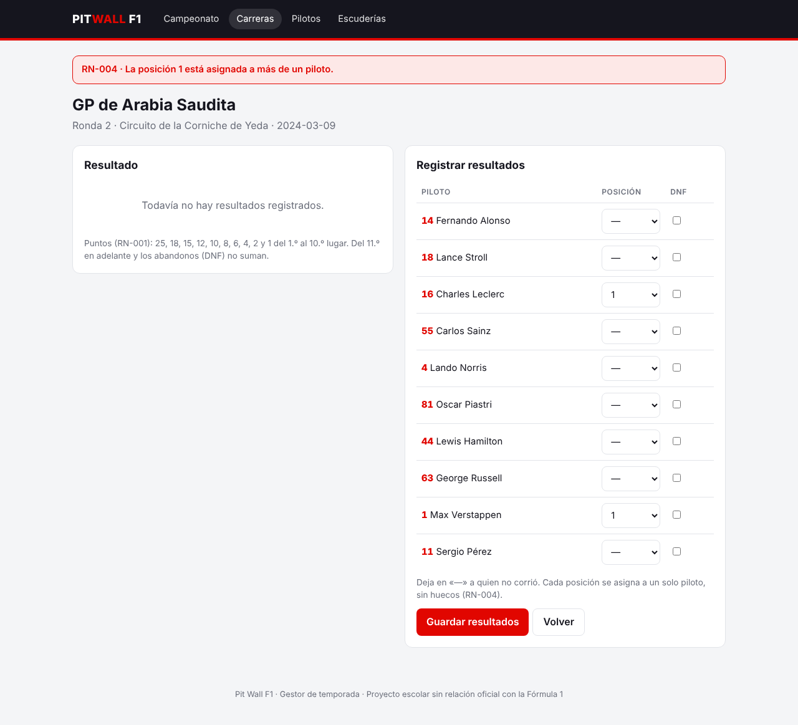

# Pit Wall F1 · Documentación

**Versión 1.0** · Aplicación web en Python para gestionar una temporada de Fórmula 1.

## 1. Descripción

Pit Wall F1 permite registrar las escuderías, los pilotos y el calendario de una temporada, capturar el resultado de cada carrera y consultar el campeonato de pilotos y de constructores, que se calcula solo a partir de los resultados.

**Usuario:** cualquier persona que lleve el registro de una temporada (aficionado, liga de simulación, profesor). No hay inicio de sesión: la aplicación es de un solo usuario.

**Alcance:** una temporada. Fuera de alcance: vueltas rápidas, sprints, penalizaciones y varias temporadas a la vez.

## 2. Tecnología

| Capa | Herramienta |
|---|---|
| Lenguaje | Python 3.11+ |
| Web | Flask 3 con plantillas Jinja2 (HTML renderizado en el servidor) |
| Base de datos | SQLite (módulo `sqlite3` de Python) |
| Servidor en producción | Gunicorn |
| Pruebas | pytest |
| Despliegue | Render (`render.yaml`) o cualquier plataforma con `Procfile` |

## 3. Requerimientos funcionales

| Clave | Requerimiento |
|---|---|
| RF-01 | Registrar, consultar, editar y eliminar escuderías (nombre y país). |
| RF-02 | Registrar, consultar, editar y eliminar pilotos (nombre, número, nacionalidad y escudería). |
| RF-03 | Registrar, consultar, editar y eliminar carreras (ronda, Gran Premio, circuito y fecha). |
| RF-04 | Registrar y corregir el resultado de una carrera: posición de cada piloto o abandono (DNF). |
| RF-05 | Calcular los puntos de cada resultado según la tabla de puntuación. |
| RF-06 | Mostrar el campeonato de pilotos y el de constructores ordenados. |
| RF-07 | Avisar en pantalla, con la clave de la regla, cuando una operación incumple una regla de negocio. |

## 4. Historias de usuario

| Clave | Historia |
|---|---|
| HU-01 | Como organizador, quiero registrar las escuderías para armar la parrilla. |
| HU-02 | Como organizador, quiero registrar a los pilotos con su número y escudería para saber quién corre. |
| HU-03 | Como organizador, quiero registrar el calendario para saber qué carreras faltan. |
| HU-04 | Como organizador, quiero capturar el resultado de cada carrera para que se asignen los puntos. |
| HU-05 | Como organizador, quiero que no se pueda borrar información con historial para no perder resultados. |
| HU-06 | Como aficionado, quiero ver el campeonato ordenado para saber quién va ganando. |

## 5. Reglas de negocio

Programadas en `app/reglas.py`. Cada una tiene pruebas en `tests/test_reglas.py` con su clave en el nombre de la prueba (por ejemplo, `test_rn002_...`).

| Clave | Regla | Severidad | Historia | Criterio de aceptación |
|---|---|---|---|---|
| RN-001 | Puntos 25, 18, 15, 12, 10, 8, 6, 4, 2 y 1 del 1.º al 10.º lugar. Del 11.º en adelante y los abandonos no suman. | Alta | HU-04 | Dado un piloto que termina 1.º, cuando se guardan los resultados, entonces suma 25 puntos. |
| RN-002 | Una escudería tiene como máximo 2 pilotos, al registrar o al cambiar de escudería. | Alta | HU-02 | Dada una escudería con 2 pilotos, cuando se registra un tercero, entonces se rechaza con el aviso RN-002. |
| RN-003 | El número de piloto va del 1 al 99 y no se repite. | Media | HU-02 | Dado el número 16 ocupado, cuando otro piloto lo pide, entonces se rechaza con el aviso RN-003. |
| RN-004 | En una carrera, cada piloto tiene un solo resultado y cada posición un solo piloto; las posiciones van seguidas desde el 1.º. | Alta | HU-04 | Dados dos pilotos en 1.er lugar, cuando se guardan, entonces se rechazan y no se guarda nada. |
| RN-005 | Solo se registran resultados de carreras cuya fecha ya pasó; una carrera con resultados no se mueve al futuro. | Media | HU-04 | Dada una carrera de mañana, cuando se registran resultados, entonces se rechazan con el aviso RN-005. |
| RN-006 | No se elimina un piloto con resultados ni una escudería con pilotos. | Media | HU-05 | Dado un piloto con resultados, cuando se intenta eliminar, entonces se rechaza con el aviso RN-006. |
| RN-007 | El campeonato se ordena por puntos; en empate, más victorias y después más segundos lugares. | Baja | HU-06 | Dados dos pilotos empatados a 25 puntos, entonces va primero el que tiene una victoria. |

## 6. Casos de uso

### CU-01 Registrar un piloto
- **Actor:** organizador.
- **Flujo principal:** 1) Entra a *Pilotos*. 2) Captura nombre, número, nacionalidad y escudería. 3) Presiona *Agregar*. 4) El sistema valida RN-002 y RN-003, guarda y muestra «Piloto registrado.».
- **Flujo alterno:** si la escudería ya tiene 2 pilotos o el número está ocupado, el sistema no guarda y muestra el aviso de la regla.

### CU-02 Registrar el resultado de una carrera
- **Actor:** organizador.
- **Flujo principal:** 1) Entra a *Carreras* y elige una. 2) Asigna la posición de cada piloto o marca DNF. 3) Presiona *Guardar resultados*. 4) El sistema valida RN-004 y RN-005, calcula los puntos (RN-001), guarda y actualiza el campeonato.
- **Flujo alterno:** si hay posiciones repetidas, huecos o la carrera es futura, no se guarda nada y se muestra el aviso.

### CU-03 Consultar el campeonato
- **Actor:** organizador o aficionado.
- **Flujo principal:** 1) Entra a *Campeonato*. 2) El sistema muestra pilotos y constructores ordenados según RN-007, y el calendario con las carreras pendientes.

### CU-04 Eliminar un piloto o una escudería
- **Actor:** organizador.
- **Flujo principal:** 1) Presiona *Eliminar*. 2) El sistema valida RN-006 y elimina.
- **Flujo alterno:** si tiene historial, no se elimina y se muestra el aviso RN-006.

## 7. Modelo de datos

| Tabla | Campos | Restricciones |
|---|---|---|
| escuderias | id, nombre, pais | nombre único |
| pilotos | id, nombre, numero, nacionalidad, escuderia_id | numero único; escuderia_id → escuderias |
| carreras | id, ronda, nombre, circuito, fecha | ronda única |
| resultados | id, carrera_id, piloto_id, posicion, abandono, puntos | (carrera, piloto) único; (carrera, posición) único; se borran con su carrera |

Los puntos de constructores son la suma de los puntos de los pilotos que hoy pertenecen a cada escudería.

## 8. Arquitectura

```
Navegador ──HTTP──▶ rutas.py (pantallas) ──▶ reglas.py (reglas de negocio) ──▶ SQLite
                         │                          │
                    templates/ (HTML)        ReglaNegocioError("RN-###")
```

Toda escritura a la base de datos pasa por `reglas.py`. Si una operación incumple una regla, se lanza `ReglaNegocioError` con la clave de la regla y la pantalla la muestra como aviso, sin guardar nada.

## 9. Pruebas

28 pruebas automatizadas con pytest, todas en verde:

- `tests/test_reglas.py`: al menos una prueba por regla RN-001 a RN-007.
- `tests/test_web.py`: que cada pantalla cargue, que el CRUD funcione desde la web y que los avisos RN-002 y RN-006 aparezcan.

Para correrlas: `pytest`. Solo las de reglas: `pytest -k rn -v`.

## 10. Despliegue

El repositorio incluye `render.yaml` para desplegar en Render con el plan gratuito (New + → Blueprint). El paso a paso está en el `README.md`. En el plan gratuito la base de datos vuelve a los datos de ejemplo cada vez que el servicio se reinicia.

## 11. Capturas


*Campeonato de pilotos y constructores con el resultado del GP de Baréin 2024.*


*Resultado de una carrera y formulario para corregirlo.*


*RN-002: al intentar agregar un tercer piloto a Red Bull Racing.*


*RN-004: dos pilotos en el 1.er lugar; no se guarda nada.*
